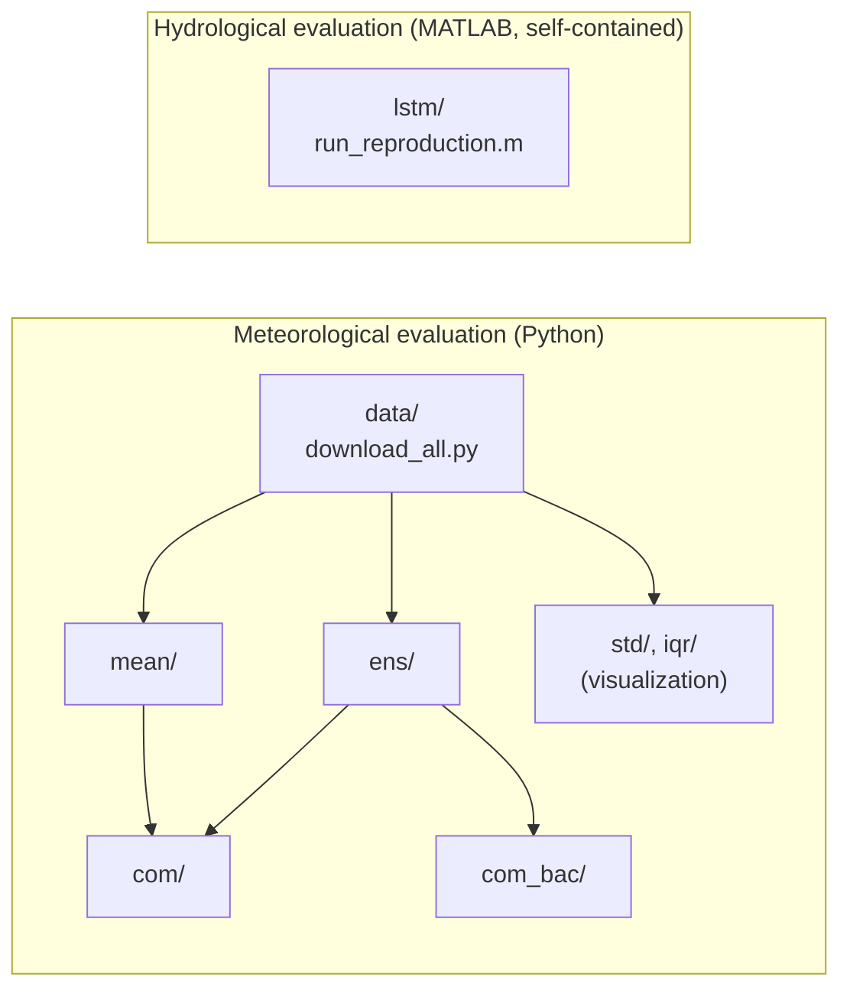

<div align="center">

# Toward Fully AI-Based Flood Forecasting: Coupling Machine Learning Radar Nowcasting and Data-Driven Hydrological Modelling

[](https://www.python.org/)
[](https://numpy.org/)
[](https://pandas.pydata.org/)
[](https://xarray.dev/)
[](https://matplotlib.org/)
[](https://pysteps.github.io/)
[](https://www.mathworks.com/products/matlab.html)
[](./LICENSE)


</div>

<br>

## 📌 Description
This repository contains tools and scripts for evaluating the **meteorological and hydrological performance** of two radar-based nowcasting models:

- [**LDCast**](https://github.com/MeteoSwiss/ldcast), released by [MeteoSwiss](https://www.meteoswiss.admin.ch/)
- [**GPTCast**](https://github.com/DSIP-FBK/GPTCast), released by [Fondazione Bruno Kessler (FBK)](https://www.fbk.eu/)

The evaluation is carried out on two significant rainfall events over the **Seveso River basin (hydraulic node of Milan)**:
- **14 – 15 September 2023**
- **31 October – 1 November 2023**

The repository includes methods for:
- Visualization of radar precipitation forecasts vs observations
- Ensemble's basic statistics (Mean, Standard Deviation, Interquartile Range)
- Meteorological skill score calculation (CRPS, FSS, SAL, Rank Histogram)
- Center of Mass and Cumulative Precipitation Analysis
- Hydrological evaluation: water-level forecasts of the Seveso River at **Palazzolo** obtained by driving LSTM networks with LDCast and GPTCast nowcasts (lead times of 10 – 60 min), compared with benchmarks (persistence, LSTM without rainfall forecast, LSTM forced with observed radar and rain-gauge rainfall) through NSE, KGE, KGE', peak error and peak timing error

Code release for the paper **"Toward Fully AI-Based Flood Forecasting: Coupling Machine Learning Radar Nowcasting and Data-Driven Hydrological Modelling"**

Paper: [\Toward Fully AI-Based Flood Forecasting: Coupling Machine Learning Radar Nowcasting and Data-Driven Hydrological Modelling]()

Data: [\AGGIUNGERE]()

---

## 📂 Repository Structure

This repository is organized into dedicated folders, each containing scripts for specific processing and analysis workflows. The radar analysis (meteorological evaluation) is written in **Python** (Jupyter notebooks), while the hydrological evaluation is a self-contained **MATLAB** package. Below is a clear overview of each directory and its purpose.

- [**data/**](./data) — contains *`download_all.py`*, a Python script used to download **input** and **prediction files**, the shapefiles of the Seveso sub-basins (*`nodo_idraulico_shape/`*) and of the area used for the hydrological-scale analysis (*`extent_prova/`*), and the cumulative rainfall observed by the ARPA rain gauges (*`{month}_cum.xlsx`*);
- [**ens/**](./ens) — contains *`{month}_{model}_ens`*, used to concatenate **input** and **prediction files** and visualize all 20 ensemble members;
- [**mean/**](./mean) — contains *`{month}_{model}_mean`*, used to compute the ensemble **mean**;
- [**std/**](./std) — contains *`{month}_{model}_std`*, used to compute the ensemble **standard deviation**;
- [**iqr/**](./iqr) — contains *`{month}_{model}_iqr`*, used to compute the ensemble **interquartile range** (IQR);
- [**com/**](./com) — contains *`{month}_ld_gpt_scores`*, used to calculate spatial metrics between observed and predicted rasters at the **meteorological context scale** and **cumulative precipitation** over the basin;
- [**com_bac/**](./com_bac) — contains *`{month}_ld_gpt_scores_bac`*, used to calculate spatial metrics between observed and predicted rasters at the **hydrological context scale** and **center of mass tracking**;
- [**lstm/**](./lstm) — MATLAB reproducibility package for the **hydrological evaluation**. *`run_reproduction.m`* drives the trained LSTM networks (*`model/lstm_networks.mat`*, one per lead time) with the areal rainfall of the three Seveso sub-basins (rain gauges, observed radar, LDCast and GPTCast nowcasts, in *`data/`*) to forecast the **water level at Palazzolo**, and computes benchmarks, **metrics** and **figures**; *`reference_output/`* contains the outputs produced by the authors. See [`lstm/README.md`](./lstm/README.md) for details.

Here `{month}` is `sept` or `oct` and `{model}` is `ld` (LDCast) or `gpt` (GPTCast).

### Workflow



---

## ⚙️ How to run

### 1. Install dependencies

Clone the repository and install dependencies:

```bash
git clone https://github.com/<username>/LDCast-GPTCast-flood-nowcasting.git
cd LDCast-GPTCast-flood-nowcasting
pip install -r requirements.txt
```

Or, with Conda:

```bash
conda env create -f environment.yml
conda activate LDCast-GPTCast-flood-nowcasting
```

Saving the animations (`animation.mp4`) requires [ffmpeg](https://ffmpeg.org/): it is included in the Conda environment, while with `pip` it must be installed separately.

The hydrological evaluation in [`lstm/`](./lstm) requires **MATLAB R2024a** (tested) with the **Deep Learning Toolbox** (see step 6).

### 2. Download input and prediction files

Run the script *`download_all.py`* from the [`data/`](./data) folder to download input and prediction files:

```bash
cd data
python download_all.py
```

The notebooks expect the following files in [`data/`](./data), with `{month}` = `sept`, `oct`:

| File | Content |
|---|---|
| `predictions_{month}_input_xarray.zarr` | observed radar sequences used as input by both models |
| `predictions_{month}_xarray.zarr` | LDCast predictions |
| `predictions_{month}_GPT_xarray.zarr` | GPTCast predictions |

### 3. Concatenate input and prediction files

Open the notebooks in the [`ens/`](./ens) folder and run them to concatenate input and prediction files and visualize the ensemble members. Each notebook writes in its own folder one NetCDF file per forecast and ensemble member (*`{input start time}_{member}_utm32n.nc`*, reprojected to WGS 84 / UTM 32N), which are used in step 5.

### 4. Compute ensemble statistics

Run the notebooks in the [`mean/`](./mean), [`std/`](./std) and [`iqr/`](./iqr) folders to compute ensemble mean, standard deviation and interquartile range. These notebooks read the files downloaded in step 2 directly and write *`{input start time}_ensemble_{mean|std|iqr}_utm32n.nc`* files in their own folder, together with plots and animations. Note: if you are only interested in spatial metrics, running the notebooks in [`mean/`](./mean) is sufficient (the ensemble mean is used for the cumulative precipitation analysis in [`com/`](./com)); [`std/`](./std) and [`iqr/`](./iqr) are used for visualization only.

### 5. Compute spatial metrics

Once the notebooks in [`ens/`](./ens) and [`mean/`](./mean) have been run, you can run the notebooks in [`com/`](./com) and [`com_bac/`](./com_bac) to compute spatial metrics at the meteorological and hydrological context scale and to obtain Center of Mass Tracking and Cumulative Precipitation Analysis.

### 6. Hydrological evaluation (LSTM, MATLAB)

The [`lstm/`](./lstm) folder is self-contained: the areal rainfall series of the three Seveso sub-basins (rain gauges, observed radar, LDCast and GPTCast nowcasts at lead times of 10 – 60 min) and the observed water levels at Palazzolo are already included, so it does not depend on steps 1 – 5. Open MATLAB in the [`lstm/`](./lstm) folder and run:

```matlab
run_reproduction
```

or, from a terminal:

```bash
cd lstm
matlab -batch "run_reproduction"
```

The script writes to `lstm/output/` the simulated hydrographs, the evaluation metrics (`metrics.csv`, `metrics.xlsx`) and the figures of the hydrological evaluation; the folder [`lstm/reference_output/`](./lstm/reference_output) contains the outputs produced by the authors, for comparison. Model inputs, benchmarks, evaluation window and metrics are described in [`lstm/README.md`](./lstm/README.md).

> **Note:** the LSTM model is the subject of a separate, not yet published study. The trained networks in [`lstm/model/`](./lstm/model) are provided only to reproduce the results of this work: please do not redistribute them or use them for other purposes (see [`lstm/README.md`](./lstm/README.md) and [License](#-license)).

---

## 📄 License

This repository is released under the [MIT License](./LICENSE), **with the exception of the trained LSTM networks** in [`lstm/model/`](./lstm/model) (`lstm_networks.mat`). The networks are not covered by the MIT License: they are provided solely to reproduce the results of the associated paper and may not be redistributed, modified or used for other purposes without the prior written permission of the authors.

---
